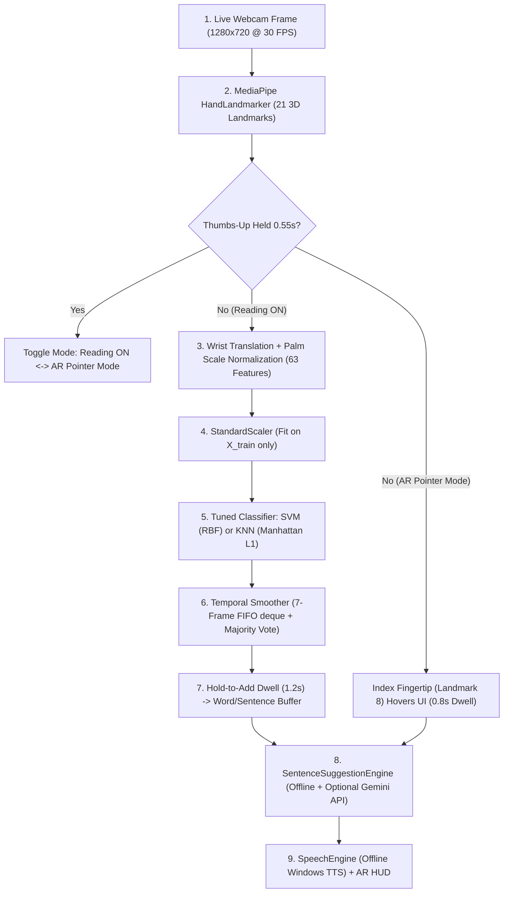

# Complete Project Documentation: Real-Time ASL Sign Language to English Translator

**Course:** Machine Learning (Practical) — `AI-3202` (Complex Computing Activity — Lab 14)  
**Institution:** Dawood University of Engineering & Technology (DUET), Karachi  
**Department:** Department of Artificial Intelligence (Batch 2023-F)  
**Student:** Muhammad Huzaifa Iftikhar  
**Instructor:** Engr. Hamza Farooqui  

---

## 1. What This Project Does (From Zero to End Result)

This system translates **American Sign Language (ASL)** hand gestures (`A` through `Z`) into **English letters, complete sentences, and spoken audio** in real time using a standard webcam.

Instead of feeding raw camera pixels into a heavy deep-learning image classifier (which breaks easily when lighting or backgrounds change), this project converts the human hand into **21 3D geometric skeleton points**, normalizes them into **63 scale- and position-invariant numbers**, and classifies them in **under 0.25 milliseconds** using tuned classical Machine Learning models (**SVM** and **KNN**).

On top of classification, the application provides an **Augmented Reality (AR) Heads-Up Display (HUD)** with:
1. **Temporal Frame-Smoothing** so predictions do not flicker.
2. **Thumbs-Up Mode Switching** (turn letter reading **ON** or switch to **AR Pointer Mode** mid-air).
3. **AR Fingertip Selection** (point your index finger at suggested sentences in mid-air to select them).
4. **Smart Sentence Suggestions** (instant offline shorthand + fuzzy matching, plus optional **Gemini API** `gemini-3.5-flash-lite` completions).
5. **Offline Text-to-Speech** so the computer speaks the finished sentence aloud.

---

## 2. End-to-End System Architecture



---

## 3. How We Collect Hand Samples & Convert Hands into Machine-Readable Data

A machine learning model like SVM or KNN cannot understand a raw JPEG/webcam image directly—it needs a **fixed-length vector of numbers** where each column always means the exact same anatomical measurement.

### Step A: Extracting 21 3D Hand Landmarks (`src/hand_tracker.py`)
We use **MediaPipe HandLandmarker** (supporting both modern Tasks API `hand_landmarker.task` and legacy Solutions API). For every frame, MediaPipe locates **21 specific 3D keypoints** `(x, y, z)` on the hand:
* `0`: Wrist (base of palm)
* `1–4`: Thumb (`CMC`, `MCP`, `IP`, `TIP`)
* `5–8`: Index finger (`MCP`, `PIP`, `DIP`, `TIP`)
* `9–12`: Middle finger (`MCP`, `PIP`, `DIP`, `TIP`)
* `13–16`: Ring finger (`MCP`, `PIP`, `DIP`, `TIP`)
* `17–20`: Pinky finger (`MCP`, `PIP`, `DIP`, `TIP`)

### Step B: Making the Coordinates Position- and Size-Invariant (Lab 01 Math)
Raw MediaPipe `(x, y, z)` coordinates change depending on *where* your hand is on screen (left vs. right) and *how close* your hand is to the camera (big vs. small). If we trained on raw coordinates, moving your hand 10 cm to the left would confuse the model.

To solve this, both `data/collect_landmarks.py` (`_normalize_raw_landmarks`) and `src/preprocessing.py` (`normalize_live_landmarks`) apply **exact two-step geometric normalization**:

1. **Wrist-Relative Translation (Position Invariance):**
   Subtract the wrist coordinate $\mathbf{p}_0$ from every landmark $\mathbf{p}_i$:
   $$\mathbf{p}_i' = \mathbf{p}_i - \mathbf{p}_0 \quad \forall i \in \{0, \dots, 20\}$$
   Now the wrist is always at $(0, 0, 0)$ regardless of where the hand appears in the webcam frame.

2. **Palm-Size Scaling (Distance / Hand-Size Invariance):**
   Compute the Euclidean distance from the wrist to the middle finger knuckle ($\text{Landmark } 9$, i.e. $\|\mathbf{p}_9'\|_2$) and divide every coordinate by it:
   $$\mathbf{p}_i'' = \frac{\mathbf{p}_i'}{\|\mathbf{p}_9'\|_2}$$
   Now a large hand close to the camera and a small hand far from the camera produce the exact same numerical proportions.

3. **Flattening to 63 Numerical Features:**
   The 21 normalized 3D points $(x, y, z)$ are flattened into a **63-element feature vector** (`x0, y0, z0, ..., x20, y20, z20`) and saved alongside the target `label` (`A`–`Z`)—creating a **64-column CSV dataset**.

---

## 4. Data Collection & Quality Measures (`data/collect_landmarks.py`)

Collecting clean training data is the single biggest factor in real-world accuracy. The interactive collector (`data/collect_landmarks.py`) enforces several quality measures:

1. **HD Capture & Mirrored View:** Captures at `1280×720` (`30 FPS`) and flips horizontally (`cv2.flip(frame, 1)`) so the user sees a natural mirror view while signing.
2. **3-Second Pose Countdown (`[ENTER]`):** Instead of recording immediately when you press a key (which captures blurry mid-air hand movement), `[ENTER]` triggers a 3-second countdown so you can form the exact ASL pose cleanly, then captures **100 clean frames** automatically and stops.
3. **Incremental Auto-Save & Multi-CSV Sync:** Every 25 frames are flushed to disk automatically and synchronized across `custom_landmarks.csv` and `sign_landmarks.csv`.
4. **Built-In Pose Coach for Ambiguous Letters:** The HUD displays tailored pose instructions for visually similar ASL signs:
   * `G` vs `H`: Turn hand sideways so the camera sees 1 vs. 2 horizontal fingers.
   * `U` vs `V`: Squeeze index & middle tightly together for `U`; spread them in a wide peace sign for `V`.
   * `K`: Tilt hand ~15° sideways so 3D depth distinguishes it from `R` and `V`.
   * `N` vs `M`: Tilt fist slightly forward so the tucked thumb tip is visible.
   * `O`: Angle hand ~30° so the hollow circle is visible.
5. **Safe Re-Recording (`[C]` Double-Confirm + Backup):** Pressing `C` twice within 0.4–4.0s wipes only the active letter—and automatically saves a timestamped `backup_before_clearing_*.csv` first so data is never lost by accident.

---

## 5. Data Cleaning, Outlier Trimming & Preprocessing (Lab 01 — `src/preprocessing.py`)

Before any model trains, `load_preprocessed_data()` executes a strict preprocessing pipeline:

1. **Missing-Value & Duplicate Checks:** Imputes any numeric nulls with column medians, drops rows missing a target label, and removes duplicate rows.
2. **Automated Anomaly Detection (`filter_dataset_anomalies`):**
   * During live webcam recording, a few frames at the start/end of a batch can be blurry transition frames.
   * For each letter class, the pipeline computes the **robust class centroid** (coordinate-wise median in 63-D space) and the Euclidean distance $d_i = \|\mathbf{x}_i - \boldsymbol{\mu}_c\|_2$ of each sample from its class centroid.
   * Any frame exceeding $\text{median}(d) + 2.2 \times \text{std}(d)$ is trimmed as an outlier.
   * On the custom dataset (`12,026` raw samples), this removed `479` noisy frames (`4.0%`), retaining **`11,547` high-precision samples** across all 26 classes.
3. **Label Encoding & Stratified Split:** Converts `A–Z` to integers `0–25` and performs a **stratified 80/20 split** (`9,237` train / `2,310` test samples) with `random_state=42` so every letter keeps balanced representation.
4. **Leakage-Free Z-Score Standardization:** Fits `StandardScaler` **strictly on `X_train`** (`fit_transform`), then transforms `X_test` using the fitted training mean and standard deviation (`transform`).

---

## 6. Machine Learning Models & Hyperparameter Tuning (Labs 06 & 08)

Both required course algorithms are trained (`src/train.py`) and tuned via 5-fold stratified `GridSearchCV` (`src/tune.py`):

### Model 1: Support Vector Machine (Lab 06 — `SVC`)
* **How it works:** Projects the 63-D hand keypoints using a non-linear **Radial Basis Function (RBF) kernel**, $K(\mathbf{x}_i, \mathbf{x}_j) = \exp(-\gamma \|\mathbf{x}_i - \mathbf{x}_j\|^2)$, to separate complex 3D finger geometries with maximum margin.
* **Tuned Hyperparameters (`GridSearchCV`):** `kernel='rbf'`, `C=20.0`, `gamma=0.05`, `probability=True` (Platt scaling for live confidence bars).
* **Baseline vs. Tuned:** Improved test accuracy from `96.54%` (baseline) to **`99.70%`** on the latest cleaned custom split (`99.78%` on the 11,120-sample tuning benchmark).

### Model 2: K-Nearest Neighbors (Lab 08 — `KNeighborsClassifier`)
* **How it works:** Instance-based classifier that compares a live hand vector to stored training exemplars and predicts by neighbor voting.
* **Tuned Hyperparameters (`GridSearchCV` & Task 7 K-Sensitivity):** `metric='manhattan'` ($L_1$ norm—more effective than Euclidean $L_2$ in 63-D space), `n_neighbors=1`, `weights='uniform'`.
* **Performance:** **`98.96%` test accuracy** and **`0.143 ms`** average inference latency on the latest custom split.

### Side-by-Side Benchmark Summary (Custom Lab Dataset)
| Metric | SVM (Lab 06 — Tuned RBF) | KNN (Lab 08 — Tuned Manhattan) |
| :--- | :---: | :---: |
| **Test Accuracy** | **99.70%** | 98.96% |
| **Macro Precision** | **99.72%** | 99.01% |
| **Macro Recall** | **99.69%** | 98.97% |
| **Macro F1-Score** | **99.70%** | 98.98% |
| **Inference Latency** | 0.212 ms / sample | **0.143 ms / sample** |

*(A dual-dataset comparison against the static `Kaggle Benchmark` dataset is also supported via `python src/train.py --dataset all` and `[D]` in the live app.)*

---

## 7. Real-Time Translation, AR Controls, Sentence Suggestions & Speech (Labs 13 & 14)

### A. Temporal Frame-Smoothing (`TemporalSmoother` in `src/utils.py`)
Single-frame predictions can jitter during hand motion. `TemporalSmoother` keeps a 7-frame FIFO `collections.deque` of `(letter, confidence)` pairs, filters out frames below `CONFIDENCE_THRESHOLD = 0.50`, and uses `collections.Counter` majority voting—marking a gesture **CONFIDENT** once at least `3` consecutive/modal frames agree.

### B. Thumbs-Up Mode Toggle & AR Air-Touch Pointer (`app.py`, `src/utils.py`)
* **Thumbs-Up Detector (`is_thumbs_up`):** Checks geometrically (normalized by palm size) that thumb tip `4` is extended vertically above thumb IP `3`, MCP `2`, and index knuckles `5/6`, while all 4 fingers (`8, 12, 16, 20`) are curled compactly into the palm. Holding Thumbs-Up for `0.55s` (2.0s cooldown) toggles **Reading ON $\leftrightarrow$ AR Pointer Mode**.
* **AR Pointer Mode:** Pauses letter reading so hand movement does not type random letters. Tracks the **index fingertip (Landmark 8)** with exponential smoothing (`0.55 * prev + 0.45 * curr`) as a glowing reticle; hovering over any suggested sentence or HUD button for **`0.80s`** fills a dwell ring and triggers it.

### C. Hybrid Sentence Suggestion & Offline Speech (`src/sentence_engine.py`)
* **`SentenceSuggestionEngine`:**
  * **Instant Offline Engine (<1 ms):** Combines symbol-triggered phrases (`A–Z`), ASL shorthand/gloss expansion (`WTR`, `HLP`, `TY`, `HW`, `GM`, `DUET`, `ML`), multi-word context scoring, and subsequence/`difflib` fuzzy matching.
  * **Optional Async Gemini API (`gemini-3.5-flash-lite`):** If `.env` contains `GEMINI_API_KEY` and `google-genai` is installed, queries Gemini in a background daemon thread and caches results—never blocking webcam FPS and falling back to the offline engine if offline.
* **`SpeechEngine`:** Uses a background worker thread + `queue.Queue` calling Windows' built-in `System.Speech.Synthesis.SpeechSynthesizer` (`CREATE_NO_WINDOW`) so spoken sentences never freeze the video stream.

---

## 8. File-by-File Project Map

| File / Folder | Purpose |
| :--- | :--- |
| [config.py](file:///D:/UNI/ML/sign-language-translator/config.py) | Central paths, 26 ASL labels, SVM/KNN hyperparameters, MediaPipe (`0.50`) & smoother (`7` frames, `0.50` conf, `3` stable) settings |
| [app.py](file:///D:/UNI/ML/sign-language-translator/app.py) | Main real-time webcam translator, Thumbs-Up toggle, AR pointer, touch/mouse callbacks, and keyboard shortcuts |
| [src/hand_tracker.py](file:///D:/UNI/ML/sign-language-translator/src/hand_tracker.py) | Universal MediaPipe 21-landmark extractor & skeletal renderer |
| [src/preprocessing.py](file:///D:/UNI/ML/sign-language-translator/src/preprocessing.py) | Lab 01 cleaning, centroid anomaly filtering, label encoding, 80/20 split, and `StandardScaler` |
| [src/train.py](file:///D:/UNI/ML/sign-language-translator/src/train.py) | Labs 06 & 08 training, evaluation reports, confusion matrices, and model serialization |
| [src/tune.py](file:///D:/UNI/ML/sign-language-translator/src/tune.py) | 5-fold stratified `GridSearchCV` hyperparameter optimizer + heatmaps |
| [src/sentence_engine.py](file:///D:/UNI/ML/sign-language-translator/src/sentence_engine.py) | Offline + optional async Gemini sentence suggestions and non-blocking Windows TTS |
| [src/utils.py](file:///D:/UNI/ML/sign-language-translator/src/utils.py) | `TemporalSmoother`, `FPSCounter`, `is_thumbs_up`, AR HUD renderer, evaluation graph viewer, and matplotlib plots |
| [data/collect_landmarks.py](file:///D:/UNI/ML/sign-language-translator/data/collect_landmarks.py) | Interactive HD webcam dataset recorder with 3s countdown, 100-sample batching, and pose coach |
| [presentation.html](file:///D:/UNI/ML/sign-language-translator/presentation.html) | Browser-based interactive presentation dashboard with all KPIs and evaluation graphs |
| [tests/test_pipeline.py](file:///D:/UNI/ML/sign-language-translator/tests/test_pipeline.py) | 7-point automated verification suite (100% pass rate) |

---

## 9. Quick Commands & Live Presentation Demo Script

### Setup & Run
```bash
pip install -r requirements.txt
python tests/test_pipeline.py   # Verify 7/7 tests pass
python app.py                   # Launch live translator
```

### Live Controls Cheat Sheet
* **`Thumbs-Up (0.55s)` or `R`**: Toggle **Letter Reading ON $\leftrightarrow$ AR Pointer Mode**
* **In AR Pointer Mode**: Point index finger at `[1]`, `[2]`, `[3]` suggestions or any button for **0.8s** to select & speak
* **`1` / `2` / `3` or Mouse Click**: Select suggested sentence and speak aloud
* **`ENTER` / `V` or `[SPEAK]`**: Speak constructed sentence aloud
* **`SPACE` / `BACKSPACE` / `A` / `X`**: Add space / delete char / add letter / clear sentence
* **`G` or `[G] EVAL GRAPHS`**: Open the in-app Model Evaluation & Graphs Viewer
* **`M` / `D` / `S` / `Q`**: Switch SVM $\leftrightarrow$ KNN / Custom $\leftrightarrow$ Kaggle / Smoothing ON $\leftrightarrow$ OFF / Quit

### Suggested 3-Minute Demo Flow for Your Professor
1. Open [presentation.html](file:///D:/UNI/ML/sign-language-translator/presentation.html) in a browser to walk through the **63-D wrist/palm normalization**, **Lab 01 anomaly filtering**, **99.70% SVM vs 98.96% KNN** table, and **GridSearchCV / Confusion Matrix** tabs.
2. Run `python app.py` (starts directly on your **Custom Lab** SVM model).
3. Sign a letter (e.g., `H` or `T`) to show live classification + confidence + 7-frame smoothing + instant sentence suggestions.
4. Hold **Thumbs-Up** (`0.55s`) to switch into **AR Pointer Mode**, point your index finger at suggestion `[1]` for `0.8s`, and let the system select and **speak the sentence aloud**.
5. Press **`M`** to demonstrate live switching between **SVM** and **KNN**, and **`G`** to pull up the evaluation graphs directly inside the app.
