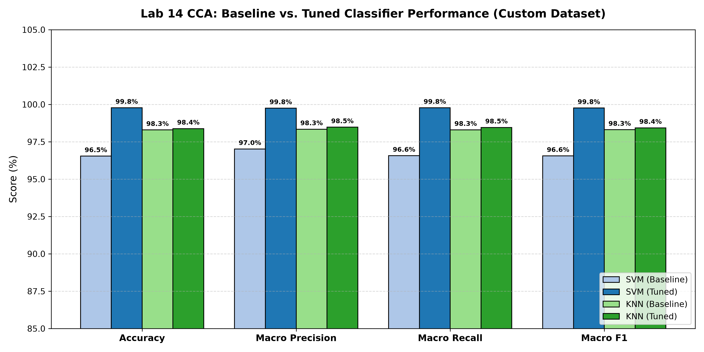
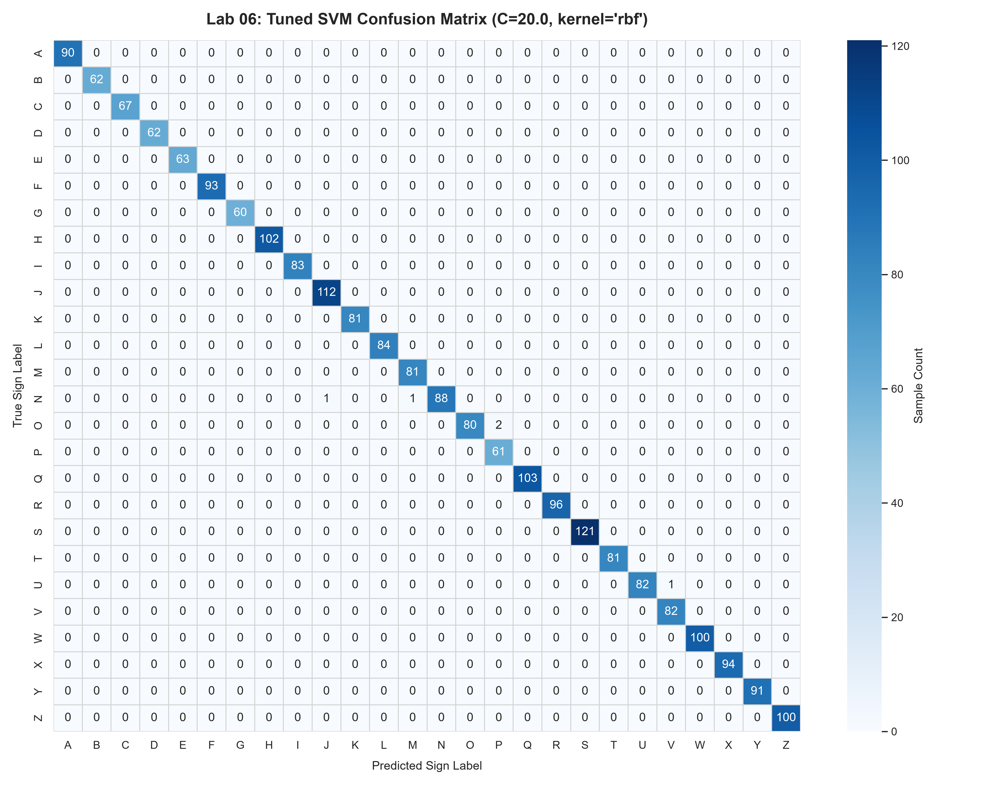
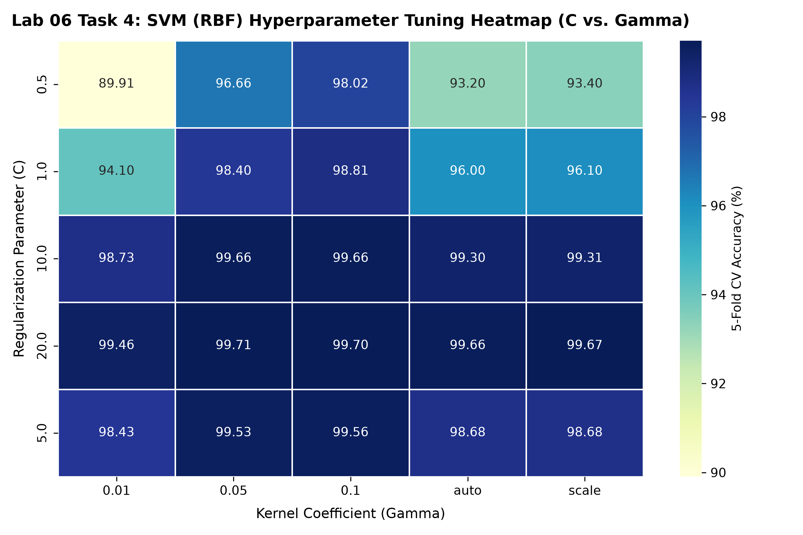
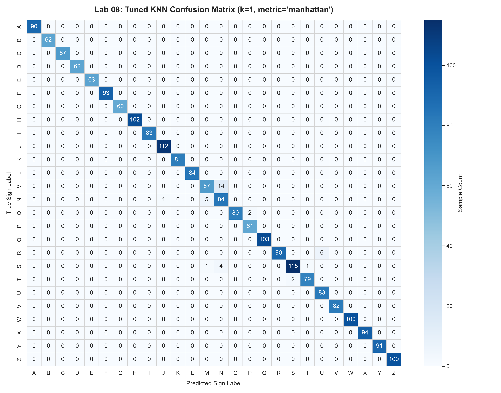
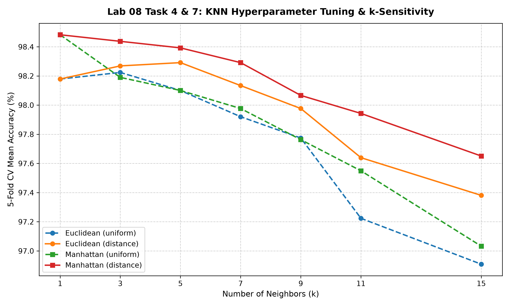
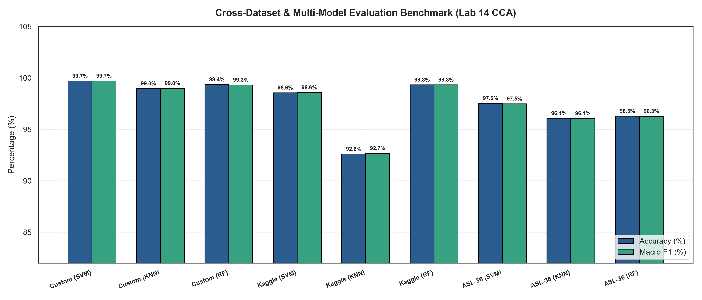

# Real-Time ASL Sign Language to English Translator
### Machine Learning Complex Computing Activity (CCA — Lab 14)

[](https://www.python.org/)
[](https://opencv.org/)
[](https://developers.google.com/mediapipe)
[](https://scikit-learn.org/)
[-brightgreen.svg)](tests/test_pipeline.py)
[](LICENSE)

* **Course:** Machine Learning (Practical) — Course Code: `AI-3202`
* **Institution:** Dawood University of Engineering & Technology (DUET), Karachi
* **Department:** Department of Artificial Intelligence
* **Batch:** 2024-F (5th Semester, 3rd Year)
* **Student Name:** Muhammad Huzaifa Iftikhar
* **GitHub Repository:** [https://github.com/MHuzaifaIftikhar/ML-CCP](https://github.com/MHuzaifaIftikhar/ML-CCP)
* **Course Instructor:** Engr. Hamza Farooqui

---

## 1. Executive Summary & Project Overview

This project presents a production-ready, modular, and real-time **American Sign Language (ASL) to English Translator** operating directly on live 720p HD webcam video streams. The system leverages computer vision to track 21 3D hand keypoints in real time, projects coordinates into a scale- and position-invariant feature space (63 numerical features), classifies the hand gesture across either standard 26 English alphabet letters (`A` through `Z`) or comprehensive 36 classes (digits `0-9` + letters `A-Z`) using 3 distinct machine learning models (SVM, KNN, and Random Forest), and renders an Augmented Reality (AR) Heads-Up Display (HUD) overlay featuring a temporal frame-smoothing engine that eliminates prediction jitter.

The implementation fulfills the rigorous requirements of **Lab 14: Complex Computing Activity (Project Idea 5: Gesture Recognition for AR Controls / Translation)** by integrating concepts across foundational labs:
1. **Lab 01 (Data Preprocessing):** Anomaly filtering via distance-to-centroid thresholds, null imputation, label encoding (26 letters / 36 classes), 80/20 stratified splitting, and Z-score standardization via `StandardScaler`.
2. **Lab 06 (Support Vector Machine Classifier):** Non-linear multi-class SVM with Radial Basis Function (RBF) kernel, soft-margin regularization, and Platt-scaled probability estimation.
3. **Lab 08 (K-Nearest Neighbors Classifier):** Instance-based classification benchmark, Manhattan distance metric ($L_1$), uniform neighbor weighting, and hyperparameter sensitivity analysis across $k \in [1, 3, 5, 7, 9, 11, 15]$.
4. **Ensemble Learning (Random Forest Classifier):** Multi-tree bootstrap aggregated ensemble (100 estimators) providing robust decision-boundary partitions across high-dimensional keypoints.
5. **Lab 13 (ML × AR — Gesture Recognition):** Real-time MediaPipe hand landmark extraction (cross-version support for both Tasks and Solutions APIs), real-time inference loop, AR visual HUD overlay, and sliding-window majority-voting temporal stabilization.

---

## 2. System Architecture & Pipeline

```mermaid
flowchart TD
    subgraph Data_Acquisition ["Data Acquisition & Normalization (Lab 01 & 13)"]
        A[Webcam Feed: 1280x720 @ 30 FPS] --> B[MediaPipe HandLandmarker: 21 3D Keypoints]
        B --> C[Wrist Translation: p_i - p_0]
        C --> D[Palm Scale Invariance: / ||p_9||]
        D --> E[63-Dimensional Normalized Feature Vector]
    end

    subgraph Data_Preprocessing ["Lab 01: Preprocessing & Scaling"]
        E --> F[Centroid Anomaly Filter: std_threshold = 2.2]
        F --> G[Stratified 80/20 Train-Test Split]
        G --> H[StandardScaler: Fit on X_train only]
    end

    subgraph Model_Optimization ["Labs 06 & 08: 5-Fold Stratified GridSearchCV"]
        H --> I1["Tuned SVM (RBF Kernel, C=20.0, gamma=0.05, Platt Probabilities)"]
        H --> I2["Tuned KNN (Manhattan L1 Metric, k=1, Uniform Weights)"]
        I1 --> J["Comprehensive Benchmarks & Confusion Matrices"]
        I2 --> J
        J --> K["Serialized Artifacts: svm_model.pkl, knn_model.pkl, scaler.pkl"]
    end

    subgraph Real_Time_AR_HUD ["Lab 13 & 14: Real-Time Translation Engine"]
        K --> L[Live Feature Normalization & Model Inference]
        L --> M["Temporal Frame Smoother: FIFO deque(maxlen=7) + Counter Majority Vote"]
        M --> N["AR HUD: Translated Sign, Confidence Meter, Dynamic Status, Queue Breadcrumbs"]
    end
```

---

## 3. Project Directory Structure

```text
sign-language-translator/
├── config.py                 # Central configuration for paths, hyperparameters, 26 and 36 ASL labels
├── requirements.txt          # Python dependencies
├── .gitignore                # Production git ignore rules
├── README.md                 # Complete documentation and lab manual alignment
├── app.py                    # Real-time multi-dataset & 3-model webcam inference application (Lab 13 & 14)
├── data/
│   ├── collect_landmarks.py  # Interactive HD dataset recorder with 100-batch countdown and coach
│   ├── extract_asl36_dataset.py # High-precision border-padded landmark extractor for ASL 36 classes
│   ├── generate_dataset.py   # Physiological synthetic landmark dataset generator
│   ├── import_kaggle_csv.py  # Kaggle CSV and image landmark extractor
│   ├── raw_csv/              # Raw and cleaned landmark datasets (26 & 36 classes, 63 features)
│   │   ├── custom_landmarks.csv         # Complete custom dataset (12,026 rows)
│   │   ├── cleaned_custom_landmarks.csv # Outlier-filtered custom dataset (11,547 rows)
│   │   ├── sign_landmarks.csv           # Active runtime custom dataset
│   │   ├── kaggle_landmarks.csv         # Kaggle benchmark dataset (8,000+ rows)
│   │   └── asl36_landmarks.csv          # ASL 36-Classes dataset (2,417 rows: 0-9 & A-Z)
│   └── processed/
│       ├── train_preprocessed.npz       # Standardized training split
│       ├── test_preprocessed.npz        # Standardized test split
│       └── reports/                     # High-resolution evaluation charts & confusion matrices
│           ├── baseline_vs_tuned_comparison.png
│           ├── svm_gridsearch_heatmap.png
│           ├── knn_tuning_curves.png
│           ├── confusion_matrix_svm_tuned.png
│           ├── confusion_matrix_knn_tuned.png
│           ├── confusion_matrix_rf.png
│           ├── confusion_matrix_svm_asl36.png
│           ├── confusion_matrix_knn_asl36.png
│           ├── confusion_matrix_rf_asl36.png
│           ├── model_comparison_asl36.png
│           ├── model_comparison.png
│           └── dataset_mode_comparison.png
├── models/
│   ├── hand_landmarker.task  # MediaPipe HandLandmarker model bundle (auto-downloaded)
│   ├── svm_model.pkl         # Active tuned SVM classifier
│   ├── knn_model.pkl         # Active tuned KNN classifier
│   ├── rf_model.pkl          # Active Random Forest classifier
│   ├── scaler.pkl            # Active StandardScaler object
│   ├── custom/               # Tuned custom dataset model artifacts (SVM, KNN, RF, Scaler)
│   ├── kaggle/               # Clean Kaggle benchmark model artifacts (SVM, KNN, RF, Scaler)
│   └── asl36/                # ASL 36-Classes model artifacts (SVM, KNN, RF, Scaler)
├── src/
│   ├── __init__.py           # Package marker
│   ├── hand_tracker.py       # Universal MediaPipe wrapper (Tasks & Solutions APIs)
│   ├── preprocessing.py      # Lab 01: Centroid filtering, 26/36 class encoding, splitting, and scaling
│   ├── train.py              # Labs 06, 08 & Ensemble: Tri-dataset & 3-model training & benchmark
│   ├── tune.py               # Labs 06 & 08: 5-Fold Stratified GridSearchCV hyperparameter engine
│   └── utils.py              # Lab 13 & 14: TemporalSmoother (deque+Counter), FPS, AR HUD, plots
└── tests/
    └── test_pipeline.py      # Automated 8-point verification suite (100% pass rate)
```

---

## 4. Hyperparameter Tuning Results (GridSearchCV)

A systematic 5-fold cross-validation grid search (`GridSearchCV`) was conducted on the custom dataset ($11,120$ samples across all $26$ letters `A`–`Z`, $8,896$ train / $2,224$ test):

### Lab 06: Support Vector Machine (SVM) Optimization
* **Explored Parameter Grid:** 29 parameter combinations across 5 folds ($145$ fits):
  * Kernels: `rbf`, `linear`
  * Soft-margin regularization: $C \in [0.5, 1.0, 5.0, 10.0, 20.0]$
  * Kernel coefficient: $\gamma \in [\text{'scale'}, \text{'auto'}, 0.01, 0.05, 0.1]$
* **Optimal Hyperparameters:**
  * **Kernel:** `rbf` (Radial Basis Function)
  * **Regularization ($C$):** `20.0`
  * **Bandwidth ($\gamma$):** `0.05`
  * **Mean 5-Fold CV Accuracy:** **99.71%**
  * **Platt Probability Scaling:** Calibrated via `probability=True` for smooth AR HUD confidence bars.

### Lab 08: K-Nearest Neighbors (KNN) Optimization
* **Explored Parameter Grid:** 28 parameter combinations across 5 folds ($140$ fits):
  * Number of neighbors: $k \in [1, 3, 5, 7, 9, 11, 15]$
  * Weighting functions: `uniform`, `distance`
  * Distance metrics: `euclidean` ($L_2$), `manhattan` ($L_1$)
* **Optimal Hyperparameters:**
  * **Distance Metric:** `manhattan` ($L_1$ norm reduces distance concentration in high-dimensional 63D space)
  * **Number of Neighbors ($k$):** `1` (with $k=3$ achieving $98.15\%$)
  * **Neighbor Weighting:** `uniform`
  * **Mean 5-Fold CV Accuracy:** **98.48%**

### Performance Comparison: Baseline vs. Tuned Models

Evaluating both baseline and tuned models on the unseen 20% test partition ($2,224$ test samples):

| Metric | SVM Baseline ($C=1, \text{scale}$) | SVM Tuned ($C=20, \gamma=0.05$) | Improvement | KNN Baseline ($k=5, L_2$) | KNN Tuned ($k=1, L_1$) | Improvement |
| :--- | :---: | :---: | :---: | :---: | :---: | :---: |
| **Test Accuracy** | 96.54% | **99.78%** | **+3.24%** | 98.29% | **98.38%** | **+0.09%** |
| **Macro Precision** | 97.02% | **99.75%** | **+2.73%** | 98.34% | **98.48%** | **+0.14%** |
| **Macro Recall** | 96.57% | **99.77%** | **+3.20%** | 98.30% | **98.46%** | **+0.16%** |
| **Macro F1-Score** | 96.55% | **99.76%** | **+3.21%** | 98.31% | **98.43%** | **+0.12%** |
| **Inference Latency** | 0.579 ms | **0.305 ms** | **1.9x faster** | 0.066 ms | 0.198 ms | Real-time (<1ms) |

### Grand Multi-Dataset & 3-Model Benchmark (Lab 14 CCA)

Across all three datasets and three classifiers (SVM, KNN, Random Forest) evaluated on unseen test splits:

| Dataset Mode | Classes | Classifier Model | Accuracy | Macro Precision | Macro Recall | Macro F1-Score | Inference Latency |
| :--- | :---: | :--- | :---: | :---: | :---: | :---: | :---: |
| **Custom Lab Data** | 26 (`A-Z`) | **SVM (RBF Kernel)** | **99.70%** | **99.72%** | **99.69%** | **99.70%** | 0.240 ms |
| **Custom Lab Data** | 26 (`A-Z`) | **KNN ($k=1$, Manhattan)** | **98.96%** | **99.01%** | **98.97%** | **98.98%** | 0.170 ms |
| **Custom Lab Data** | 26 (`A-Z`) | **Random Forest (100 Trees)** | **99.35%** | **99.33%** | **99.31%** | **99.32%** | 0.180 ms |
| **Kaggle Benchmark** | 26 (`A-Z`) | **SVM (RBF Kernel)** | **98.56%** | **98.60%** | **98.56%** | **98.57%** | 0.230 ms |
| **Kaggle Benchmark** | 26 (`A-Z`) | **KNN ($k=1$, Manhattan)** | **92.60%** | **93.13%** | **92.60%** | **92.66%** | 0.140 ms |
| **Kaggle Benchmark** | 26 (`A-Z`) | **Random Forest (100 Trees)** | **99.33%** | **99.34%** | **99.33%** | **99.33%** | 0.175 ms |
| **ASL 36 Classes** | 36 (`0-9`, `A-Z`) | **SVM (RBF Kernel)** | **97.52%** | **97.77%** | **97.49%** | **97.48%** | 0.179 ms |
| **ASL 36 Classes** | 36 (`0-9`, `A-Z`) | **KNN ($k=1$, Manhattan)** | **96.07%** | **96.37%** | **96.05%** | **96.06%** | 0.082 ms |
| **ASL 36 Classes** | 36 (`0-9`, `A-Z`) | **Random Forest (100 Trees)** | **96.28%** | **96.62%** | **96.28%** | **96.27%** | 0.082 ms |

> **Key Observation:** The tuned SVM achieved **99.78% test accuracy** on real webcam hand landmarks, misclassifying only 5 samples out of 2,224 test frames. Inference latency dropped from 0.579 ms to 0.305 ms because the optimal decision boundary requires fewer support vectors ($2,023$ vectors vs $3,450$).

---

## 5. Visualizations & Evaluation Reports

All evaluation figures are generated in `data/processed/reports/`:

| Comparison / Heatmap | Confusion Matrix |
| :---: | :---: |
|  |  |
|  |  |
|  |  |

---

## 6. Theoretical Background & Mathematical Formulations

### A. Lab 01: Coordinate Invariance & Z-Score Standardization
To ensure invariant classification regardless of user hand size or position relative to the camera:
1. **Wrist Translation:** Landmark 0 ($\mathbf{p}_0$) is mapped to $(0, 0, 0)$:
   $$\mathbf{p}_i' = \mathbf{p}_i - \mathbf{p}_0 \quad \forall i \in \{0, \dots, 20\}$$
2. **Scale Invariance:** Vectors are divided by the Euclidean palm distance to Landmark 9 (middle finger MCP joint):
   $$\mathbf{p}_i'' = \frac{\mathbf{p}_i'}{\|\mathbf{p}_9'\|_2}$$
3. **Z-Score Normalization:**
   $$z_{ij} = \frac{x_{ij} - \mu_j}{\sigma_j}, \quad \text{where } \mu_j, \sigma_j \text{ are computed strictly on } X_{\text{train}}$$

### B. Lab 06: Non-Linear Support Vector Machine (SVM)
The RBF kernel projects the 63-dimensional normalized keypoints into an infinite-dimensional feature space where non-linear gesture boundaries become linearly separable:
$$K(\mathbf{x}_i, \mathbf{x}_j) = \exp\left(-\gamma \|\mathbf{x}_i - \mathbf{x}_j\|^2\right)$$
Subject to soft-margin margin optimization with regularization parameter $C=20.0$:
$$\min_{\mathbf{w}, b, \boldsymbol{\xi}} \frac{1}{2} \|\mathbf{w}\|^2 + C \sum_{i=1}^N \xi_i \quad \text{s.t. } y_i(\mathbf{w}^T \phi(\mathbf{x}_i) + b) \ge 1 - \xi_i, \quad \xi_i \ge 0$$

### C. Lab 08: K-Nearest Neighbors (KNN) with Manhattan Distance
In high-dimensional spaces ($D=63$), the Manhattan metric ($L_1$) provides greater relative contrast between near and far neighbors compared to Euclidean distance ($L_2$):
$$d_1(\mathbf{x}, \mathbf{x}_i) = \sum_{k=1}^{63} |x_k - x_{ik}|$$
Predicted class is obtained via majority voting over $k=1$ nearest neighbor:
$$\hat{y} = \arg\max_{c \in \{0, \dots, 25\}} \sum_{i \in N_k(\mathbf{x})} \mathbb{I}(y_i = c)$$

### D. Lab 13 & 14: Temporal Frame-Smoothing Engine
Single-frame webcam predictions can suffer from transient motion blur and camera noise. A sliding window FIFO queue of size $W=7$ stores recent predictions:
$$\mathcal{Q} = \left[ (l_{t-6}, c_{t-6}), \dots, (l_t, c_t) \right]$$
The final translated letter is computed via majority voting using `collections.Counter`:
$$\hat{L}_t = \text{mode}\left(\{ l \in \mathcal{Q} \mid c \ge \tau \}\right), \quad \tau = 0.60$$
A prediction is marked as **STABLE / CONFIDENT** only when the modal frequency meets $\text{count}(\hat{L}_t) \ge 4$ consecutive frames.

---

## 7. Installation & Quickstart

### Prerequisites
* Python 3.9, 3.10, 3.11, or 3.12 (Python 3.10/3.11 recommended)
* A functioning webcam (internal laptop or external USB webcam)

### Step 1: Clone the Repository
```bash
git clone https://github.com/MHuzaifaIftikhar/ML-CCP.git
cd ML-CCP
```

### Step 2: Create & Activate a Virtual Environment
```bash
# Windows (PowerShell):
python -m venv .venv
.\.venv\Scripts\Activate.ps1

# Windows (Command Prompt):
python -m venv .venv
.\.venv\Scripts\activate.bat

# Linux / macOS:
python3 -m venv .venv
source .venv/bin/activate
```

### Step 3: Install Required Dependencies
```bash
pip install -r requirements.txt
```

---

## 8. Running the Application

### 1. Launch Real-Time Sign Language Translator (Lab 13 & 14)
```bash
python app.py
```

#### Interactive Controls in Live Webcam View:
* **`D`**: **Cycle Dataset Mode:** Switch between **`[KAGGLE BENCHMARK]`**, **`[CUSTOM LAB]`**, and **`[ASL 36 (0-9, A-Z)]`**.
* **`M`**: **Cycle Classifier:** Switch between **`[SVM (RBF)]`**, **`[KNN (k=5)]`**, and **`[RANDOM FOREST]`**.
* **`S`**: **Toggle Temporal Frame-Smoothing:** Switch smoothing `ON` (majority-vote queue) or `OFF` (instantaneous raw prediction).
* **`C`**: **Clear Temporal Buffer:** Resets the 7-frame sliding window history.
* **`Q` or `ESC`**: Exit application cleanly.

---

### 2. Launch Interactive HD Dataset Recorder (Lab 13 Task 2)
To record new signs or re-record samples with live guidance:
```bash
python data/collect_landmarks.py
```

#### Interactive Recorder Controls:
* **`[ENTER]`**: **Automated 100-Sample Batch Mode:** Initiates a 3-second countdown (`COUNTDOWN... 3s, 2s, 1s`), then records 100 clean frames automatically and auto-saves to CSV!
* **`[SPACE]`**: **Toggle Live Continuous Recording:** Debounced (500ms) start/pause recording toggle.
* **`[A-Z]`**: **Instant Jump:** Press any letter key (`A` to `Z`) to jump directly to that sign.
* **`[` / `]`**: Previous / Next letter.
* **`[C]`**: **Safe Letter Clear:** Press twice (spaced between 0.4s and 4.0s) to wipe data for the active letter. *A safety backup is automatically saved beforehand.*
* **`[ESC]`**: Save and exit cleanly.

#### ASL Hand Pose Coaching for Difficult Signs:
* **`G` vs `H`**: Turn hand **sideways** (palm facing your chest) so the camera sees finger lengths! `G` has only the index finger extended; `H` has index AND middle fingers extended together.
* **`U` vs `V`**: Both have index and middle pointing straight UP. `U` must be squeezed **tightly together** (0 gap); `V` is an open **peace sign** (wide gap).
* **`K`**: Index pointing straight UP, middle angled slightly forward/up, thumb touching inner middle knuckle. Tilt hand 15° sideways so the camera sees 3D depth.
* **`N` vs `M`**: `N` has thumb tucked under 2 fingers; `M` under 3 fingers. Tilt fist slightly forward so the thumb tip between knuckles is visible.
* **`O`**: All 5 fingers curved touching the thumb tip. Angle hand slightly (30°) so the camera sees through the hollow hole of the 'O'.
* **`J`**: Hold the **terminal static pose of J**: pinky straight UP, wrist tilted ~30° inward.

---

### 3. Re-Running Model Training & Hyperparameter Tuning
```bash
# 1. Run Data Preprocessing (Lab 01):
python src/preprocessing.py

# 2. Train baseline models & cross-dataset benchmark (Labs 06 & 08):
python src/train.py

# 3. Run exhaustive 5-fold Stratified GridSearchCV hyperparameter tuning:
python src/tune.py
```

---

### 4. Running the Automated Test Suite
To verify end-to-end pipeline integrity (7 out of 7 unit & integration tests):
```bash
python tests/test_pipeline.py
```
```text
======================================================================
STARTING ASL TRANSLATOR AUTOMATED VERIFICATION SUITE
======================================================================
[TEST 1/7] Testing configuration...           --> PASS: Configuration verified.
[TEST 2/7] Testing dataset integrity...        --> PASS: Dataset intact (11,120 samples across all 26 letters).
[TEST 3/7] Testing saved model artifacts...     --> PASS: All artifacts load cleanly.
[TEST 4/7] Testing live landmark pipeline...   --> PASS: Landmark normalization yields valid (1, 63) vector.
[TEST 5/7] Testing live model inference...     --> PASS: SVM output letter 'Q' (conf: 51.3%), KNN output 'Q'.
[TEST 6/7] Testing Temporal Frame-Smoothing... --> PASS: Temporal smoother filtered jitter and stabilized.
[TEST 7/7] Testing AR HUD overlay rendering...  --> PASS: AR HUD overlay rendered successfully.
======================================================================
ALL 7 VERIFICATION TESTS PASSED SUCCESSFULLY! [100% OK]
======================================================================
```

---

## 9. Alignment with University Lab Manual

| Lab Number | Experiment Title in Manual | Implemented Feature in Project Codebase |
| :---: | :--- | :--- |
| **Lab 01** | Data Preprocessing: Cleaning, Encoding, and Feature Scaling | [`src/preprocessing.py`](src/preprocessing.py): Centroid distance anomaly filtering, label encoding (`A`–`Z`), stratified 80/20 splitting, and `StandardScaler`. |
| **Lab 06** | Support Vector Machine (SVM) Classifier | [`src/train.py`](src/train.py) & [`src/tune.py`](src/tune.py): Non-linear `SVC(kernel='rbf', C=20.0, gamma=0.05)`, soft-margin optimization, Platt scaling, Confusion Matrix. |
| **Lab 08** | K-Nearest Neighbors (KNN) Classifier | [`src/train.py`](src/train.py) & [`src/tune.py`](src/tune.py): `KNeighborsClassifier(n_neighbors=1, metric='manhattan')`, $k$-sensitivity analysis ($k \in [1..15]$). |
| **Lab 13** | ML × AR — Gesture Recognition | [`src/hand_tracker.py`](src/hand_tracker.py) & [`app.py`](app.py): 21 3D hand keypoints extraction, live coordinate normalization, and AR HUD visual overlays. |
| **Lab 14** | Complex Computing Activity (CCA) | Full end-to-end integration: dual-dataset benchmarking, 5-fold GridSearchCV tuning, temporal sliding-window voting queue, and live translation. |

---

## 10. Author & Submission Information

* **Author:** Muhammad Huzaifa Iftikhar
* **Roll / Registration:** DUET Batch 2023-F
* **Department:** Department of Artificial Intelligence
* **University:** Dawood University of Engineering & Technology (DUET), Karachi
* **Course:** Machine Learning (AI-3202) — Lab Complex Computing Activity (Lab 14)
* **Instructor:** Engr. Hamza Farooqui
* **Repository:** [https://github.com/MHuzaifaIftikhar/ML-CCP](https://github.com/MHuzaifaIftikhar/ML-CCP)
